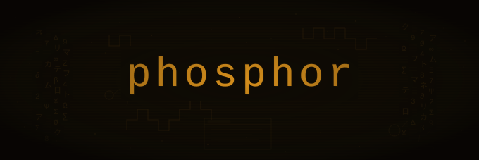

# phosphor

<p align="center">
  
</p>

**Terminal screensavers, the way they were meant to be.**

Phosphor is a screensaver system for your terminal. It watches for idle time, fades to black, and runs one of 13 built-in screensavers — or your own custom one. Named after CRT phosphor burn-in, the original reason screensavers were invented.

## Install

```bash
git clone https://github.com/colinmarc/phosphor.git
cd phosphor
./install.sh
```

This builds everything in release mode, installs the binaries to `/usr/local/bin`, and hooks into your shell. Restart your terminal and walk away — phosphor takes it from there.

**Options:**
- `--no-pam` — skip PAM lock-screen support (Linux)
- `--prefix PATH` — install somewhere other than `/usr/local/bin`

## Usage

```bash
# Launch the default screensaver
phosphor run

# Pick a specific one
phosphor run --screensaver plasma

# Split-screen (vertical | or horizontal /)
phosphor run --split "pipes|matrix_rain"

# Browse all screensavers in a live mosaic
phosphor gallery

# Preview one for a few seconds
phosphor preview aurora --duration 5

# List everything available
phosphor list

# Interactive TUI configuration
phosphor config

# Usage stats
phosphor stats
```

## Screensavers

| Name | Description |
|------|-------------|
| `analog_clock` | Clock face with hour, minute, and second hands |
| `aurora` | Northern lights with undulating ribbons of color |
| `bouncing_ball` | A ball bouncing around with a colorful trail |
| `digital_clock` | Large ASCII-art digital clock display |
| `fluid` | Navier-Stokes fluid dynamics simulation |
| `game_of_life` | Conway's Game of Life cellular automaton |
| `lissajous` | Harmonograph curves with Braille subpixel rendering |
| `matrix_rain` | Falling characters in the style of The Matrix |
| `maze` | Maze generation and solving with animated pathfinding |
| `pipes` | Random pipes with colorful box-drawing characters |
| `plasma` | Demoscene plasma effect with morphing rainbow waves |
| `starfield` | Parallax starfield flying through space |
| `terrain` | Voxel-space terrain flyover with procedural noise |

## How it works

Phosphor uses a plugin architecture. The host binary handles terminal setup, idle detection, fade transitions, the clock overlay, and optional PAM lock-screen. Each screensaver is a separate binary (`phosphor-saver-*`) that communicates with the host over stdin/stdout using a compact binary protocol.

This means screensavers are sandboxed — a crashing plugin can't corrupt your terminal — and you can write your own without touching the host code.

## Writing a plugin

Create a new Rust binary that depends on `phosphor-plugin`:

```rust
use phosphor_plugin::prelude::*;
use std::time::Duration;

struct MyPlugin;

impl ScreensaverPlugin for MyPlugin {
    fn info(&self) -> PluginInfo {
        PluginInfo {
            name: "my_screensaver".into(),
            description: "Does something groovy".into(),
            config_fields: vec![],
        }
    }

    fn init(&mut self, width: u16, height: u16) {
        // Set up state for the given terminal size
    }

    fn update(&mut self, dt: Duration) {
        // Advance simulation by dt
    }

    fn render(&self, buf: &mut PluginBuffer) {
        buf.set(0, 0, Cell {
            ch: '*',
            fg: PluginColor::Rgb(255, 200, 50),
            bg: PluginColor::Reset,
        });
    }
}

fn main() {
    phosphor_plugin::run(MyPlugin);
}
```

Name the binary `phosphor-saver-<name>`, drop it in `~/.config/phosphor/plugins/` or alongside the host binary, and it'll show up in `phosphor list`.

## Configuration

Phosphor reads `~/.config/phosphor/config.toml`. You can edit it directly or use the interactive TUI:

```bash
phosphor config
```

Settings include idle timeout, FPS, default screensaver, auto-rotate, fade transitions, clock overlay, and per-screensaver options.

## License

MIT
